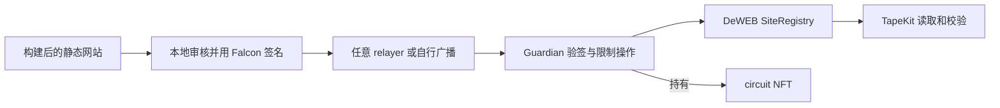

# Q-Tape

**Post-quantum publishing authority for TapeOut DeWEB sites.**

Q-Tape 把 circuit NFT 的站点控制权交给 Falcon 密钥控制的 Vault，让独立 CLI 或第三方发布工具只能执行用户明确批准的修改。

**当前状态：M1 本地 fork MVP 已实现并通过验收；M2 内部候选（安全审查准备、非零费用 fixture、Vite 适配、浏览器组件测试）已完成，但独立外部审查仍未完成。未经安全审计，未部署主网，不接收真实资产。** 正式 Vault、本地 native signer、age 加密备份、Client SDK、CLI、可替换 relayer 和只读/普通钱包 Web 已存在；TapeCI、HashPort 等第三方平台集成尚未完成，也不对外声称已集成。

## 从哪里开始

- [Spec 开发文档 v0.1](docs/SPEC-v0.1.md)：产品范围、架构、授权协议、接口、使用流程、验收标准。
- [开发计划](docs/DEVELOPMENT-PLAN.md)：从已验证 PoC 到 MVP 的实施顺序与当前状态。
- [M1 验收记录](docs/ACCEPTANCE.md)：实际命令、测试结果、覆盖映射与未完成项。
- [M2 计划](docs/DEVELOPMENT-PLAN-M2.md)、[M2 验收](docs/ACCEPTANCE-M2.md)、[M2 安全审查记录](docs/SECURITY-REVIEW-M2.md)、[Pilot 手册](docs/PILOT.md)。
- [M3 试点计划](docs/DEVELOPMENT-PLAN-M3.md)、[M3.3 self-hosted fixture 演练](docs/M3-FIXTURE.md)、[运营/监控 runbook](docs/OPERATIONS.md)。
- [发布说明](docs/RELEASE-NOTES.md)：0.1.0-m1 新增模块与已知限制。
- [CLI 使用说明](docs/CLI.md)、[集成说明](docs/INTEGRATION.md)、[relayer](docs/RELAYER.md)、[密钥与备份](docs/KEYS.md)。
- [实际验证报告](docs/VERIFICATION.md)：21 项 Foundry 测试与 5 个独立应用端本地交易行为用例；[独立仓库重跑证据](evidence/standalone-2026-11-02/README.md)。
- [M1 模块接口](docs/M1-INTERFACES.md)、[来源与依赖](docs/PROVENANCE.md)、[安全边界](SECURITY.md)、[安全审查准备](docs/SECURITY-REVIEW-PREP.md)。

## 它如何工作



网站内容继续由 SiteRegistry 和文件块合约存储。Q-Tape 保护的是 NFT 控制权与网站发布权限；不改变底层区块链的签名或共识。

## 两种使用方式

**独立使用（已实现）**：本地准备文件、审核差异、签名、提交、核验；不依赖 TapeCI 或 HashPort。完整生命周期在本地 fork 上通过（见 `docs/ACCEPTANCE.md`）。

**工具集成（SDK 已实现，平台适配未完成）**：发布平台构建产物并调用 `@qtape/client` 生成 ReleasePlan；用户在本地 Q-Tape signer 批准并签名；平台或 relayer 提交同一 SignedRequest。严格模式下不向普通 EOA operator 开放直接写入路径。示例见 [examples/publisher-adapter](examples/publisher-adapter/README.md)。

## 已验证的事实

固定 X Layer fork 区块 **74818827**，链 ID 196：

- 实验回归 21/21 Foundry 测试通过；8 笔本地交易覆盖 5 个行为用例，公网广播 0。
- 正式 Guardian 合约 51/51 Foundry 测试通过，覆盖真实 Falcon 验签、字段篡改、重放、过期、跨链/跨 Vault、旧 owner/operator/NFT approval、换钥、批次回滚。
- native signer/age 备份 22/22 测试通过（真实 PQClean 进程，不是恒真 verifier）。
- 独立 CLI 闭环通过：备份失败阻断 → 恢复演练 → 部署 → NFT 迁入 → `PROTECTED` → 发布签名/提交 → 同区块双 RPC 回读 `VERIFIED` → 换钥 → 退出。
- 发布样本使用约 3.29M gas，NFT 转出约 3.04M gas；样本测量，不构成性能承诺。

这些结论限定于所测版本、样本与本地 fork。非零续期费用、全部历史权限、TapeSend 加密消息兼容、浏览器 Falcon 签名和生产密钥管理（含多签恢复）尚未验证；测试通过不等于安全审计。

## 快速开始（本地 fork）

需要 Bun >= 1.3.10、Foundry（已测 1.7.1）、clang、git、curl，以及能读取固定历史区块的 X Layer RPC。

```bash
bun install --frozen-lockfile
bun run bootstrap
```

在另一个终端启动本机 fork：

```bash
anvil --fork-url https://rpc.xlayer.tech --fork-block-number 74818827 --chain-id 196 --host 127.0.0.1 --port 18545 --silent
```

运行验证：

```bash
bun run check
bun run verify:fork
bun run verify:environment
bun run verify:e2e
bun run verify:summary

# M1 正式合约
bun run build:contracts
(cd contracts && forge test --fork-url http://127.0.0.1:18545)

# 独立 CLI 全流程（会自行构建 artifact、创建临时 fork 代理和测试密钥）
bun run mvp:e2e
```

CLI 示例见 [docs/CLI.md](docs/CLI.md)。实验只向 loopback Anvil 写入。测试密钥在本地生成，未随仓库发布。

## 项目约定

- 默认分支：`dev`。
- 许可证：MIT；第三方依赖保留各自许可证。
- 不发币，不提供主网资金托管服务。
- `experiments/guardian-fork` 是历史可行性实验，不是正式产品；`HolderProbe` 和 `GuardianLab` 不得进入生产路径。
