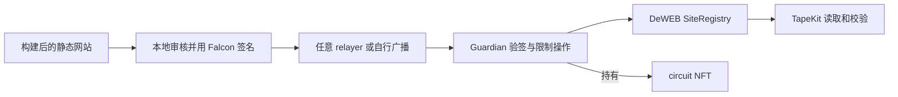

# Q-Tape

**Post-quantum publishing authority for TapeOut DeWEB sites.**

Q-Tape 把 circuit NFT 的站点控制权交给 Falcon 密钥控制的 Vault，让独立 CLI 或第三方发布工具只能执行用户明确批准的修改。

**当前状态：已验证 PoC；产品 MVP 待开发。** 尚无正式 Vault 部署、可安装的产品 CLI、托管 relayer 或浏览器签名器。当前实验合约未经安全审计，不应接收真实资产。

## 从哪里开始

- [Spec 开发文档 v0.1](docs/SPEC-v0.1.md)：产品范围、架构、授权协议、接口、使用流程、验收标准。
- [开发计划](docs/DEVELOPMENT-PLAN.md)：从已验证 PoC 到 MVP 的实施顺序。
- [实际验证报告](docs/VERIFICATION.md)：21 项 Foundry 测试与 5 个独立应用端本地交易行为用例；[独立仓库重跑证据](evidence/standalone-2026-11-02/README.md)。
- [实验复现](experiments/guardian-fork/README.md)：固定区块、工具与命令。
- [来源与依赖](docs/PROVENANCE.md)、[安全边界](SECURITY.md)。

## 它如何工作



网站内容继续由 SiteRegistry 和文件块合约存储。Q-Tape 保护的是 NFT 控制权与网站发布权限；不改变底层区块链的签名或共识。

## 两种使用方式

**独立使用（计划中）**：本地准备文件、审核差异、签名、提交、核验；不依赖 TapeCI 或 HashPort。

**工具集成（计划中）**：发布平台构建产物并生成待审请求，用户在本地 Q-Tape signer 批准，平台或 relayer 提交同一签名请求。严格模式下不向普通 EOA operator 开放直接写入路径。尚未声称与任何发布平台完成集成。

## 已验证的事实

在 X Layer 区块 **74818827** 的本地 fork 上：

- 合约持有 NFT 后可发布、追加、删除、设置 fallback 和续期。
- 所测原 owner、迁移前 Registry operator 失去直接写入权限；旧 NFT 批准者不能转走 NFT。
- 真实 PQClean Falcon-512 签名可完成授权；篡改、重放、过期、跨链和跨 Vault 请求被拒绝。
- 独立仓库重跑中，JavaScript 编码的本地发布交易使用约 **3.29M gas**，NFT 转出约 **3.04M gas**，均在本地 8M gas 上限内执行；这是样本测量，不是固定性能承诺。

这些结论限定于所测版本、样本与实验代码。非零续期费用、全部历史权限、TapeSend 加密消息兼容和生产密钥管理尚未验证。

## 复现 PoC

需要 Bun >= 1.3.10、Foundry（已测 1.7.1）、clang、git、curl，以及能读取固定历史区块的 X Layer RPC。

```bash
bun install --frozen-lockfile
bun run bootstrap
```

在另一个终端启动本机 fork：

```bash
anvil --fork-url https://rpc.xlayer.tech --fork-block-number 74818827 --chain-id 196 --host 127.0.0.1 --port 18545 --silent
```

运行验证：

```bash
bun run check
bun run verify:fork
bun run verify:environment
bun run verify:e2e
bun run verify:summary
```

实验只向 loopback Anvil 写入。测试密钥在本地生成，未随仓库发布。[初次验证](evidence/2026-11-02/README.md)与[独立仓库复现](evidence/standalone-2026-11-02/README.md)分别归档；再次运行的结果写入被忽略的实验 `results/`。

## 项目约定

- 默认分支：`dev`。
- 许可证：MIT；第三方依赖保留各自许可证。
- 不发币，不提供主网资金托管服务。
